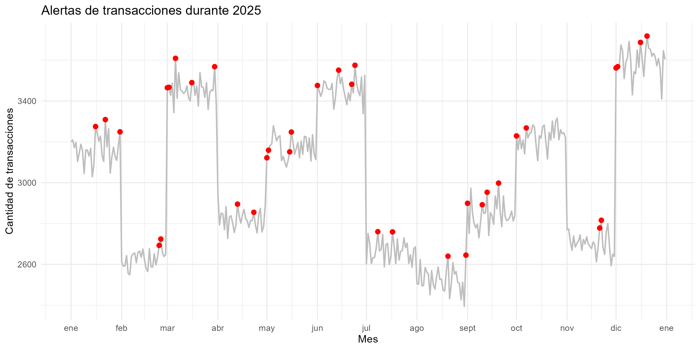
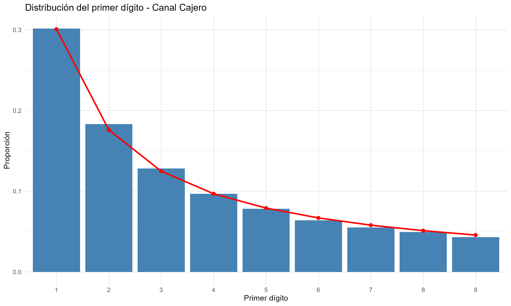
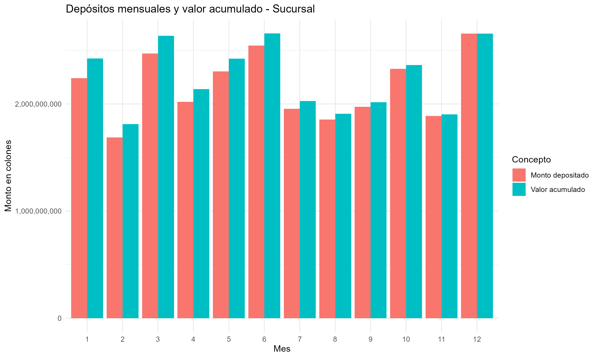

## Repositorio de GitHub

[Ver repositorio de la Tarea 3](https://github.com/britty0719/Tarea3_JimenezBrittany)


```{r}
#| include: false
source("cod/funciones_tarea3.R")
transacciones <- read.csv2("data/transacciones_2025.csv")
parametros <- read.csv2("config/parametros_tarea3.csv")
cantones <- read.csv("data/cantones.csv")

# Ejercicio 1

ventana <- as.numeric(parametros$valor[parametros$parametro == "ventana"])
k.alerta <- as.numeric(parametros$valor[parametros$parametro == "k.alerta"])

resultado <- alerta.movil(transacciones, ventana, k.alerta)
# Resultado 1A
respuesta.1A <- sum(resultado$alerta, na.rm = TRUE)

# Resultado 1B
respuesta.1B <- resultado |>
  filter(alerta == TRUE) |>
  slice_head(n = 1) |>
  pull(fecha)

# Resultado 1C
resultado.1C <- alerta.movil(transacciones, 7, 2)
respuesta.1C <- sum(resultado.1C$alerta, na.rm = TRUE)

# Ejercicio 2
canal.benford <- parametros$valor[parametros$parametro == "canal.benford"]

# Resultado 2A
resultado.2 <- filter(transacciones, canal == canal.benford)
resultado.2A <- round(benford.mad(resultado.2$monto_crc), 4)

# Resultado 2B
resultado.2B <- benford.canton(transacciones, canal.benford, cantones) |> 
  slice_head(n = 1) |> 
  pull(canton)

# Resultado 2C
resultado.2C <- benford.canton(transacciones, canal.benford, cantones) |> 
  filter(mad > 0.015)
respuesta.2C <- nrow(resultado.2C)

# Resultado 2D
resultado.2D <- benford.canton(transacciones, "Web", cantones) |> 
  slice_head(n = 1) |> 
  pull(canton)

# Ejercicio 3

tasa.anual <- as.numeric(parametros$valor[parametros$parametro == "tasa.anual"])
canal.interes <- parametros$valor[parametros$parametro == "canal.interes"]

# Resultado 3A
resultado.3 <- valor.acumulado(transacciones, tasa.anual = tasa.anual, canal = canal.interes)
resultado.3A <- round(resultado.3$va, 2)

# Resultado 3B
resultado.3B <- round(resultado.3$interes, 2)

# Resultado 3C
respuesta.3 <- valor.acumulado(transacciones, tasa.anual = 0.06, canal = "App")
resultado.3C <- round(respuesta.3$va, 2)

```

## Hoja de respuestas

```{r}
#| echo: false
#| results: asis
cat("RESULTADO_1A =", respuesta.1A, "\n\n")
cat("RESULTADO_1B =", respuesta.1B, "\n\n")
cat("RESULTADO_1C =", respuesta.1C, "\n\n")
cat("RESULTADO_2A =", round(resultado.2A, 4), "\n\n")
cat("RESULTADO_2B =", resultado.2B, "\n\n")
cat("RESULTADO_2C =", respuesta.2C, "\n\n")
cat("RESULTADO_2D =", resultado.2D, "\n\n")
cat("RESULTADO_3A =", round(resultado.3A, 2), "\n\n")
cat("RESULTADO_3B =", round(resultado.3B, 2), "\n\n")
cat("RESULTADO_3C =", round(resultado.3C, 2), "\n\n")
```

### Gráfico de alertas móviles

```{r}
#| echo: false
#| include: false
library(ggplot2)
resultado$fecha <- as.Date(resultado$fecha, format = "%Y-%m-%d")

grafico.1 <- ggplot(resultado,
       aes(x = fecha, y = n.tx)) +
  geom_line(color = "gray", linewidth = 0.7) +
  geom_point(
    data = filter(resultado, alerta == TRUE),
    color = "red",
    size = 2
  ) +
  scale_x_date(date_breaks = "1 month", date_labels = "%b") +
  labs(
    title = "Alertas de transacciones durante 2025",
    x = "Mes",
    y = "Cantidad de transacciones"
  ) +
  theme_minimal()

ggsave(
  filename = "info/figuras/alertas_moviles.png",
  plot = grafico.1,
  width = 10,
  height = 5,
  dpi = 300
)
```


### Gráfico de Benford

```{r}
#| echo: false
#| include: false
montos <- resultado.2$monto_crc
montos <- montos[!is.na(montos) & montos > 0]

digitos <- substr(as.character(montos), 1 , 1)
frecuencias <- table(factor(digitos, levels = 1:9))
  proporciones <- frecuencias/sum(frecuencias)
d <- 1:9
benford.teorico <- log10(1 + 1/d)

datos.grafico <- data.frame(
  digito = d,
  observado = as.numeric(proporciones),
  teorico = benford.teorico
)
grafico.2 <- ggplot(datos.grafico,
                    aes(x = factor(digito), y = observado)) +
  geom_col(fill = "steelblue") +
  geom_line(
    aes(y = teorico, group = 1),
    color = "red",
    linewidth = 1
  ) +
  geom_point(
    aes(y = teorico),
    color = "red",
    size = 2
  ) +
  labs(
    title = "Distribución del primer dígito - Canal Cajero",
    x = "Primer dígito",
    y = "Proporción"
  ) +
  theme_minimal()

grafico.2

ggsave(
  filename = "info/figuras/benford.png",
  plot = grafico.2,
  width = 10,
  height = 6,
  dpi = 300
)

```


### Conclusión del Ejercicio 2
Un MAD elevado no necesariamente indica fraude, ya que puede deberse al bajo número de transacciones de algunos cantones.

# Gráfico de valor acumulado

```{r}
#| echo: false
#| include: false

datos.grafico3 <- resultado.3$tabla |>
  mutate(
    acumulado = monto * factor
  )

datos.grafico3 <- datos.grafico3 |>
  tidyr::pivot_longer(
    cols = c(monto, acumulado),
    names_to = "tipo",
    values_to = "valor"
  ) |>
  mutate(
    tipo = recode(
      tipo,
      monto = "Monto depositado",
      acumulado = "Valor acumulado"
    )
  )

grafico.3 <- ggplot(
  datos.grafico3,
  aes(x = factor(mes), y = valor, fill = tipo)
) +
  geom_col(position = "dodge") +
  labs(
    title = "Depósitos mensuales y valor acumulado - Sucursal",
    x = "Mes",
    y = "Monto en colones",
    fill = "Concepto"
  ) +
  scale_y_continuous(labels = scales::label_number(big.mark = ",")) +
  theme_minimal()

ggsave(
  filename = "info/figuras/valor_acumulado.png",
  plot = grafico.3,
  width = 10,
  height = 6,
  dpi = 300
)
```

